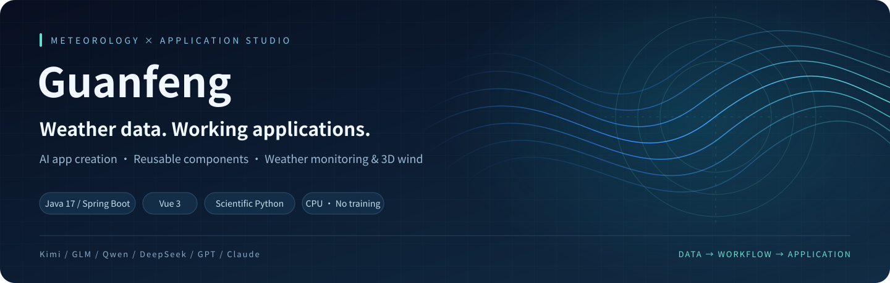
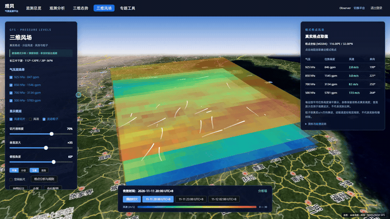
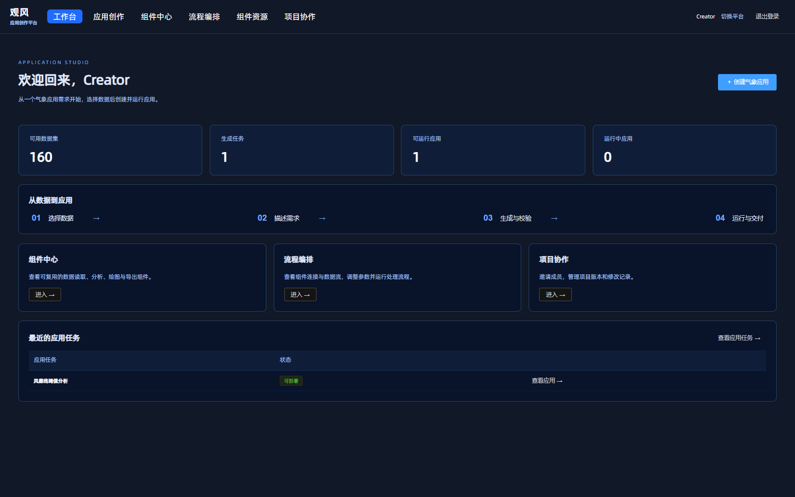
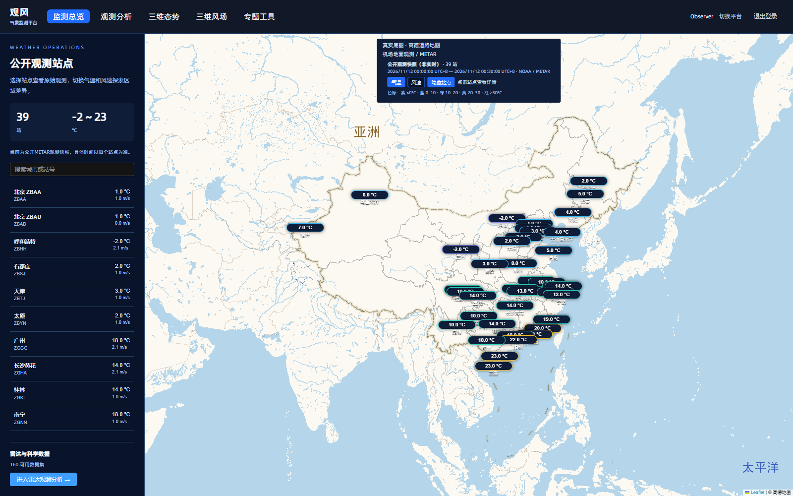
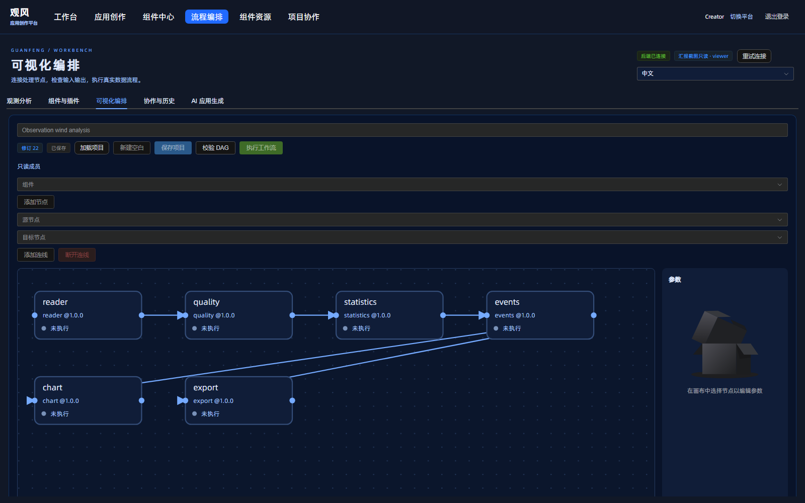
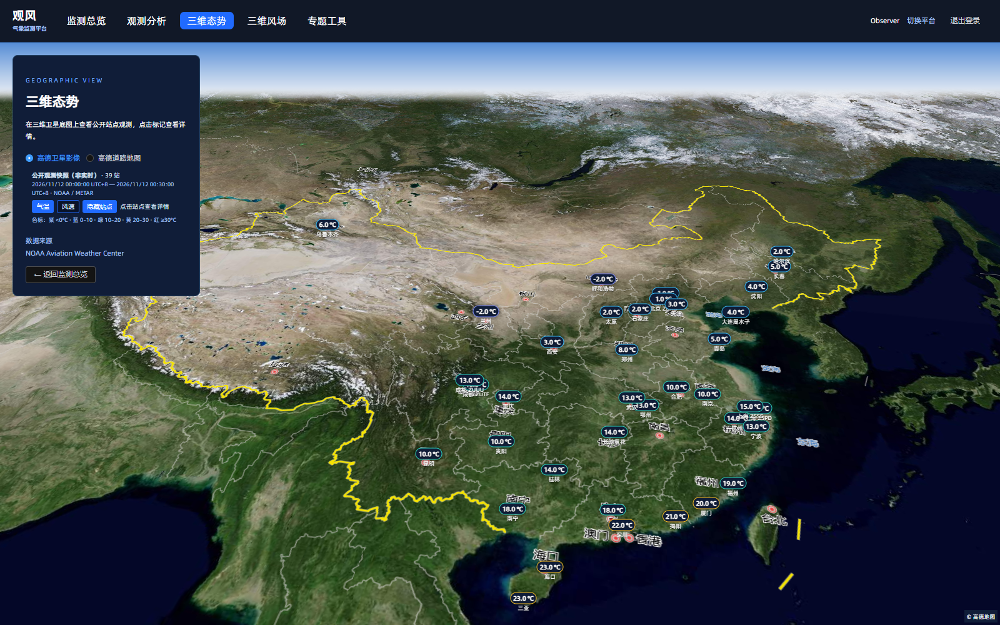
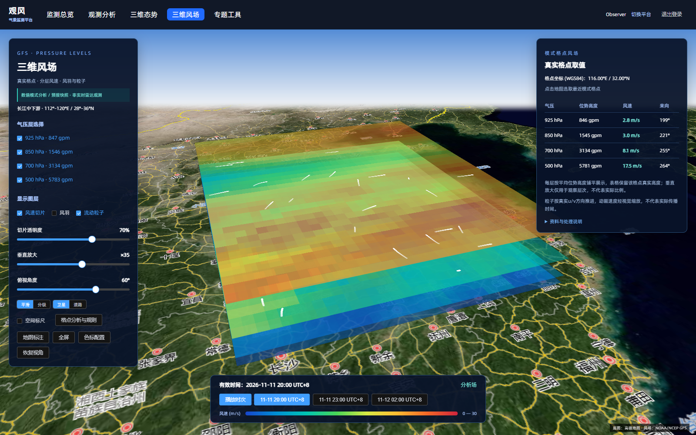
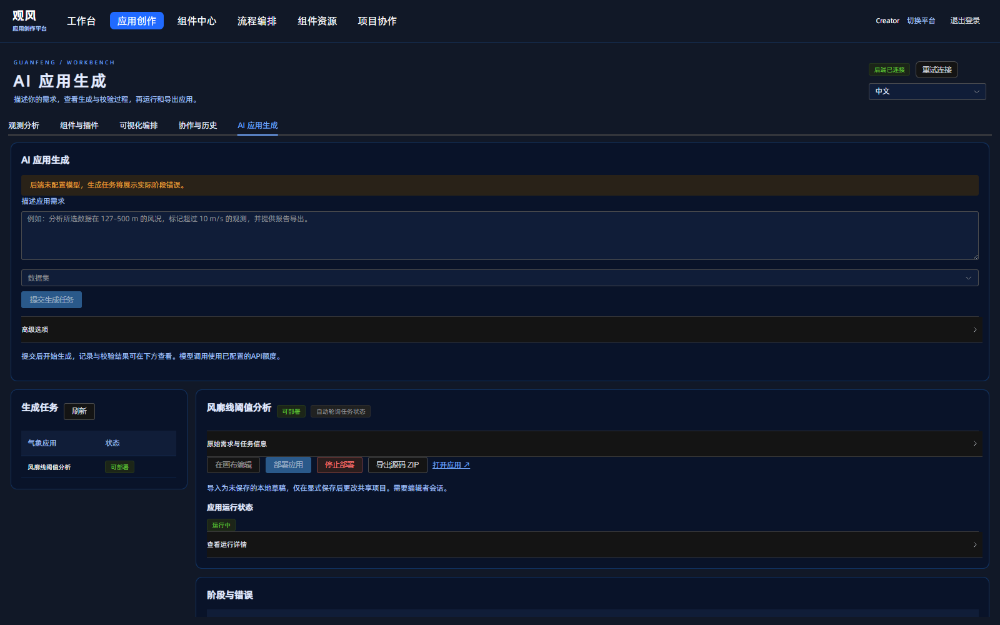
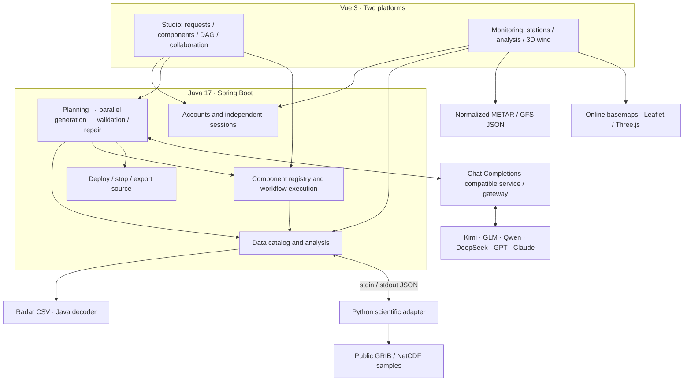

<p align="center"><a href="README.md">简体中文</a> &nbsp;|&nbsp; <strong>English</strong></p>

<div align="center">
  
  <h1>Guanfeng · 观风</h1>
  <p><strong>AI Weather Application Studio &amp; Component Library</strong></p>
  <p>Describe an analysis in natural language. Turn data, components, and workflows into a working weather application.</p>
  <p><a href="#two-platforms-two-workflows">Platforms</a> · <a href="#see-it-in-action">Screenshots</a> · <a href="#quick-start-windows">Quick start</a> · <a href="#unified-model-access">Model configuration</a> · <a href="docs/ARCHITECTURE.md">Architecture</a></p>
</div>

---

Guanfeng organizes recurring meteorological analysis steps—reading data, filtering observations, calculating statistics, detecting threshold exceedances, plotting, and exporting—into reusable components. AI agents assemble these into applications. Start with a request such as “Analyze wind-speed exceedances within a selected altitude range,” choose a dataset, follow generation and validation, then deploy the application or export its source code.

A separate monitoring platform lets you inspect original METAR reports, browse public stations, and explore GFS wind slices, wind barbs, and animated particles across multiple pressure levels.

<div align="center">
  
  <p><sub>3D wind field · Actual system recording · GFS model snapshot</sub></p>
</div>

**Java 17 / Spring Boot handles application logic and agent orchestration; Vue 3 handles interaction and visualization; Python decodes scientific files.** Local services and decoding run on a CPU. Generation calls your configured model API; no model training or locally hosted LLM is required. The browser uses WebGL for 3D rendering.

## Two platforms, two workflows

| | Application Studio | Weather Monitoring |
| :--- | :--- | :--- |
| Entry | `/login-cloud` → `/cloud` | `/login-network` → `/operations` |
| Start with | A dataset and an application request | A station or a public observation snapshot |
| Explore | AI generation, components, visual workflows, collaboration | Observation analysis, 3D stations, wind fields, specialist tools |
| Deliver | Validated apps, running URLs, source ZIPs, workflows, analysis exports | Station details, raw reports, charts, grid values, data exports |

**Creation:** select data → describe the task → plan and generate code → validate, build, and repair → deploy and open → export source or stop.

**Monitoring:** select a station → switch temperature / wind speed → inspect timestamps and raw reports → analyze observations → explore stations and GFS fields in 3D.

The platforms maintain separate login sessions. Project collaboration has its own invitations and editor / read-only roles; signing into the studio does not replace project permissions.

## See it in action

These are actual system screenshots. Task lists, revisions, and counters reflect the captured state. **A fresh installation starts without generated tasks.** The UI shown is in Chinese; this English README documents the same system.

<table>
  <tr>
    <td width="50%"><strong>Application Studio</strong><br />Datasets, generation tasks, and app entry points.<br /></td>
    <td width="50%"><strong>Weather Monitoring</strong><br />Station lists linked to public observations on a map.<br /></td>
  </tr>
  <tr>
    <td><strong>Visual workflows</strong><br />Connect reading, quality control, statistics, events, charts, and exports.<br /></td>
    <td><strong>3D station view</strong><br />Explore station observations over satellite imagery.<br /></td>
  </tr>
</table>

**Real GFS wind data:** four pressure levels and three times, with speed slices, wind barbs, particles, grid-point inspection, and u/v exports.



<details>
<summary><strong>More: application generation and deployment</strong></summary>



This screenshot shows an earlier task. Its banner also indicates that no model is configured on that backend. Deploying existing source and requesting new generation are separate operations; a fresh installation does not include this task or a configured API.

</details>

## How it works

| Capability | Implementation |
| :--- | :--- |
| Request to application | Java loads the generation Skill and data / component context, plans a workflow, generates Vue and API modules in parallel, and assembles `App.vue`, `api.js`, and `workflow.json`. |
| Validation and repair | Source restrictions, actual Vite builds, DAG validation, real-data analysis, workflow execution, and browser checks gate the `ready` state. Failed output can undergo up to two repair rounds. |
| Application lifecycle | Only validated tasks can deploy. Running URLs, stop controls, and source export are provided; stages, model-call metadata, and validation outcomes are retained locally. |
| Reusable analysis | Java executes data reading, quality control, statistics, threshold events, chart data, and exports. Component IDs, versions, and input / output contracts connect into a DAG. |
| Scientific files | Java calls Python through stdin/stdout JSON. cfgrib / ecCodes decode GRIB; xarray / netCDF4 process NetCDF. The frontend consumes normalized results. |
| Collaboration | Revisions, invitations, editor / read-only roles, diffs, and rollback. Project permissions and platform login are separate. |
| Maps and wind | Leaflet maps and Three.js layers display public stations and GFS fields. Road, satellite, and terrain basemaps vary by view. |

Generation has defined data and output contracts: it produces small Vue weather-analysis apps using existing local APIs. Arbitrary code execution, unrestricted scientific-file parsing, and arbitrary business-system generation are outside the current scope.

## Unified model access

**Kimi · GLM · Qwen · DeepSeek · GPT · Claude**

Configure an endpoint, model ID, and credential file through one model client, reusing Guanfeng's planning, generation, validation, and runtime pipeline. Use a provider's **Chat Completions-compatible endpoint or compatible gateway**. Other native protocols require an adapter.

### 1. Prepare a credential file

The default is `config/model-api.key` at the repository root. Create it yourself and save **one unquoted API token on a single UTF-8 line**. Never commit it. You can also store the file outside the repository and set an absolute path with `GUANFENG_KEY_FILE`.

The current client accepts 16–512 characters consisting of letters, digits, underscores, and hyphens. Other credential formats require a client adjustment.

### 2. Configure the PowerShell session that starts the services

```powershell
# Or use an absolute path to a credential file outside this checkout.
$env:GUANFENG_KEY_FILE = Join-Path (Get-Location) 'config\model-api.key'

# Code defaults; replace these with your provider's endpoint and model ID.
$env:GUANFENG_MODEL_ENDPOINT = 'https://api.deepseek.com/chat/completions'
$env:GUANFENG_MODEL = 'deepseek-flash'

.\scripts\start.ps1
```

| Setting | Meaning |
| :--- | :--- |
| `GUANFENG_KEY_FILE` | Credential file path. Explicit `start.ps1 -KeyFile` takes precedence; otherwise defaults to this checkout's `config/model-api.key`. |
| `GUANFENG_MODEL_ENDPOINT` | The **complete `/chat/completions` URL**, including any `/v1` prefix. Paths are not appended automatically. Remote endpoints require HTTPS; loopback endpoints may use HTTP. |
| `GUANFENG_MODEL` | A model ID supported by your provider, including `provider/model` forms. `deepseek-flash` is the code default; availability depends on your service and access. |
| `GUANFENG_MODEL_RESPONSE_FORMAT` | Requests a JSON object by default. Set to `false` if the service does not support this field; output must still satisfy the source-generation JSON contract. |

The project does not automatically load `.env`. After changing configuration, stop and restart the services from the configured shell. Browsing, analysis, and workflow features work without a key; new AI generation requires valid configuration and available provider quota.

Compatibility follows these protocol and output contracts, rather than certifying every provider and model version. See [model configuration](docs/MODEL_API.md) and [DeepSeekClient.java](backend/src/main/java/com/leice/radar/demo/generation/DeepSeekClient.java).

## Architecture



Preparation scripts produce METAR and GFS JSON snapshots, loaded directly by monitoring views without model calls. The [architecture guide](docs/ARCHITECTURE.md), currently in Chinese, details source entry points, call paths, validation gates, and data boundaries.

## Quick start (Windows)

### Install the tools

Install these tools and verify them in a **new PowerShell session**:

| Tool | Version and purpose |
| :--- | :--- |
| JDK | **17** for Java compilation and runtime. Set `JAVA_HOME` to the JDK directory. |
| Maven | **3.9.x** for Java builds; add its `bin` directory to `PATH`. |
| Node.js | **20+**, including `node` and `npm`, for the frontend and generated apps. |
| Python | **3.11+**, available as `python`, for decoding and browser-check dependencies. |

```powershell
git clone https://github.com/cuitao223/guanfeng.git
cd guanfeng

java -version
mvn -version
node --version
npm --version
python --version
```

Scripts discover JDK 17 through `JAVA_HOME` or `PATH`, and other tools through `PATH`. JDK and Maven are not bundled. Optional tools under this checkout's `.tools` take precedence. With several JDKs installed, point `JAVA_HOME` to JDK 17.

### Install, build, and start

Run at the repository root:

```powershell
# Install dependencies and build the project.
powershell -NoProfile -ExecutionPolicy Bypass -File .\scripts\setup.ps1

# Start both services.
powershell -NoProfile -ExecutionPolicy Bypass -File .\scripts\start.ps1

# Stop this checkout's services.
powershell -NoProfile -ExecutionPolicy Bypass -File .\scripts\stop.ps1
```

You can also double-click `安装依赖.cmd`, `启动.cmd`, and `停止.cmd` for setup, start, and stop. Setup installs Playwright Chromium for application checks. Dependency downloads, online basemaps, and model APIs need network access.

| Service | Default address |
| :--- | :--- |
| Frontend | `http://127.0.0.1:5274/` |
| Spring Boot backend | `http://127.0.0.1:18180/` |
| Health through the frontend proxy | `http://127.0.0.1:5274/api/wb/health` |

`scripts/start.ps1` runs Vite and Spring Boot on loopback addresses and records process ownership. Use `start.ps1 -Build` after code changes. Customize ports with `-FrontendPort` and `-BackendPort`; stopping only affects recorded processes belonging to this checkout.

### Local demo accounts

| Platform | Username | Initial password |
| :--- | :--- | :--- |
| Application Studio | `creator` | `Guanfeng2026!` |
| Weather Monitoring | `observer` | `Guanfeng2026!` |

Accounts initialize on the first backend start; existing files are preserved. Backend restarts require logging in again. These accounts are independent of model API credentials; see [PortalAuthService.java](backend/src/main/java/com/leice/radar/demo/auth/PortalAuthService.java).

For a first visit, open monitoring and analyze an available dataset. In the studio, browse components and workflows, then configure a model to generate your own application. Generation history starts empty.

## Data sources and interpretation

| Data | Source and coverage | Interpretation |
| :--- | :--- | :--- |
| Radar CSV | DBS profiles and PPI samples in `data/radar/`, decoded by the Java component. | Historical files. PPI measures radial wind, not a full horizontal wind vector. Samples without real site coordinates are not placed at invented locations. |
| ERA5 | A 2017 GRIB1 reanalysis sample distributed with ECMWF/cfgrib. The adapter selects the first time, member 0, and 850 hPa; variables include `t` / `z`. | Original units are retained. Pressure-level reanalysis is not a surface observation and is not fused or synchronized with radar. |
| GOES-16 | Historical NOAA/NESDIS ABI C13 NetCDF from 2024-01-01. `DQF == 0` pixels are selected and a sampled grid is returned. | Infrared brightness temperature in K, not near-surface air temperature. Subsampling is not regridding or interpolation. |
| METAR | 39 public NOAA Aviation Weather Center station snapshots, **2026-11-12 00:00–00:30 China Standard Time (UTC+8)**. | Not live data or project-owned radar devices. Station IDs, raw reports, timestamps, and coordinates are preserved. |
| GFS | NOAA/NCEP GFS 0.25°, initialized at **2026-11-11 12:00 UTC**; f000 / f003 / f006; 925 / 850 / 700 / 500 hPa; 112°–120°E, 28°–36°N. | Model analysis / forecast snapshots, not radar. Layers use mean geopotential heights for display; particle speed is not a physical propagation time. |

See [data interpretation](docs/DATA_SOURCES.md) and [third-party notices](THIRD_PARTY_NOTICES.md). URLs, download times, hashes, and usage details are in [source notes](data/public/SOURCES.md), the [ERA5 / GOES manifest](data/public/manifest.json), [METAR manifest](data/public/map-observations/manifest.json), and [GFS manifest](data/public/gfs-wind/manifest.json). Radar statistics follow actual file contents, rather than representing live device connections.

The scientific adapter handles the listed samples with defined variables and slices; unrestricted GRIB / NetCDF uploads and cross-source fusion are not implemented. Missing values are not fabricated. Statistics preserve valid counts and provenance; user-selected thresholds are analysis settings, not industry safety standards.

The platform implements local account verification, separate sessions, and page access control. Compatibility routes remain for older business APIs and generated apps; **complete API authorization and per-account data isolation are not implemented**. Source restrictions and generation gates are not an operating-system sandbox.

## Repository guide

```text
guanfeng/
├─ frontend/             Vue 3 platforms, studio, maps, and wind views
├─ backend/              Java 17 / Spring Boot services and agent orchestration
├─ adapters/             Python scientific-data adapters
├─ generation-template/  Build, source validation, runtime, and browser checks
├─ .harness/             Development rules, generation Skill, components, templates
├─ data/                 Radar samples, public scientific data, source manifests
├─ config/               Model configuration guidance; create your own key
├─ scripts/              Windows setup, start, stop, and verification
├─ tests/                Data, Java integration, and browser checks
└─ docs/                 Guides, architecture, and actual screenshots
```

The repository does not bundle `.tools`, `node_modules`, `dist`, `target`, `runtime`, API keys, or pre-generated tasks. Competition reports and presentations are not needed to run it. Dependencies, builds, and runtime data are created locally during setup and use.

| Learn more | Document |
| :--- | :--- |
| Architecture, generation, and source entry points | [Architecture](docs/ARCHITECTURE.md) |
| Model endpoints, credentials, and protocols | [Model API](docs/MODEL_API.md) |
| Platform workflows and sessions | [Platform guide](docs/PORTAL_GUIDE.md) |
| GRIB / NetCDF decoding contract | [Scientific adapter](adapters/README.md) |
| GFS visualization and scientific boundaries | [3D wind fields](docs/REAL_WIND_SCENE.md) |
| Components and resource entry points | [Tools and entry points](docs/RESTORED_ENTRIES.md) |
| Data provenance and interpretation | [Data sources](docs/DATA_SOURCES.md) |
| Third-party resources and license scope | [Third-party notices](THIRD_PARTY_NOTICES.md) |

Supporting technical guides linked above are currently in Chinese. Both README editions cover setup, model configuration, features, and data interpretation.
