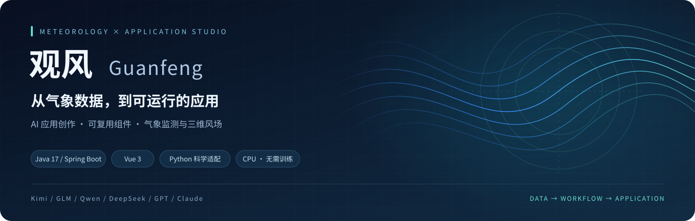
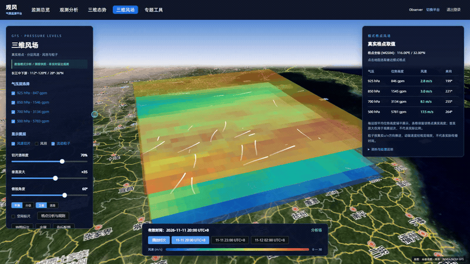
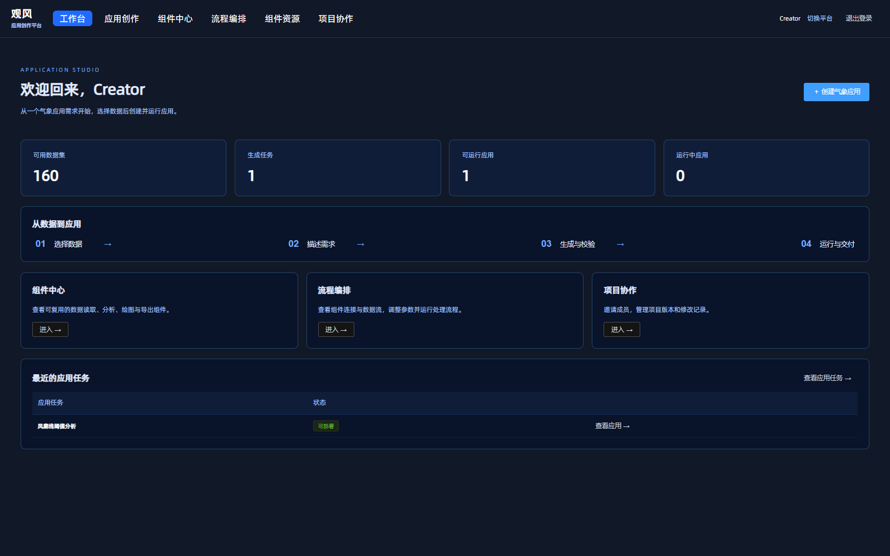
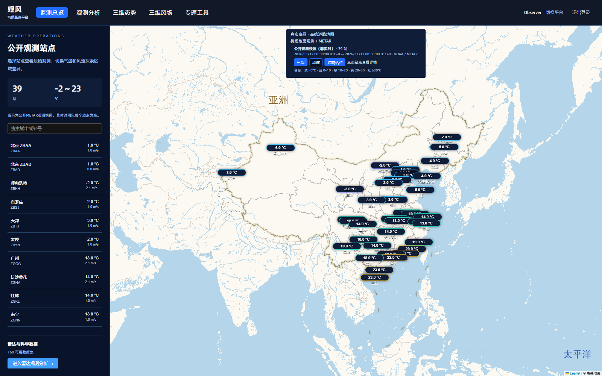
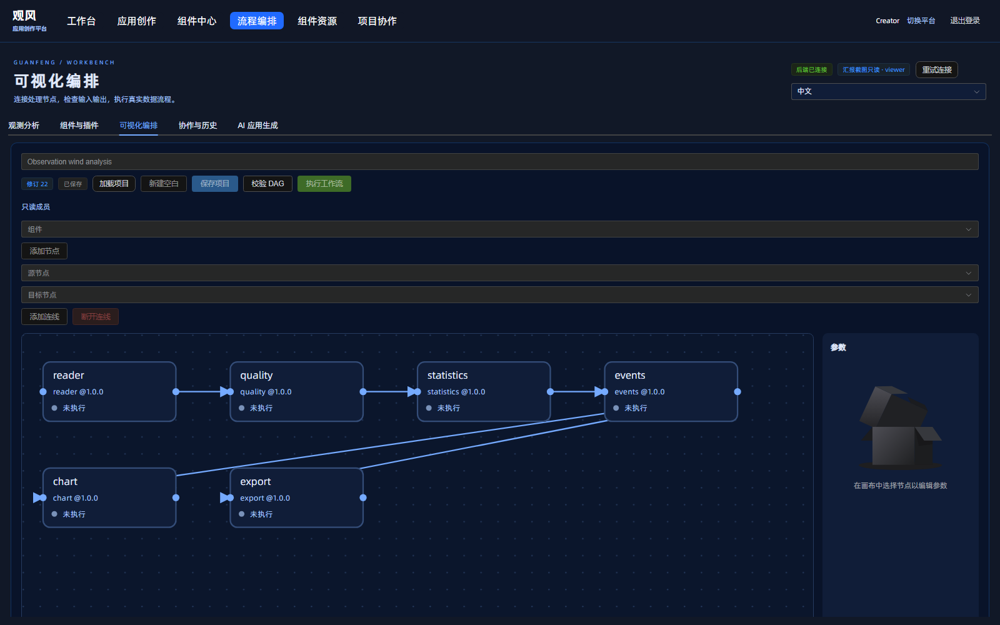
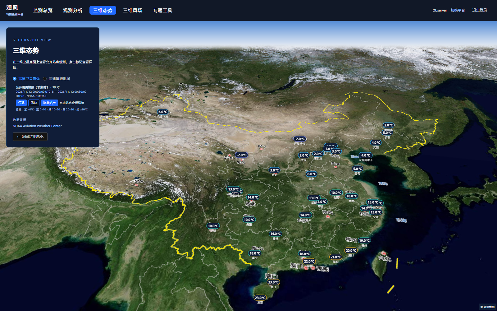
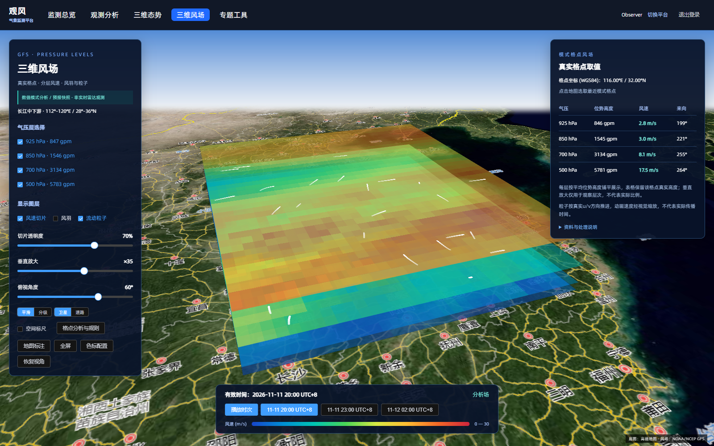
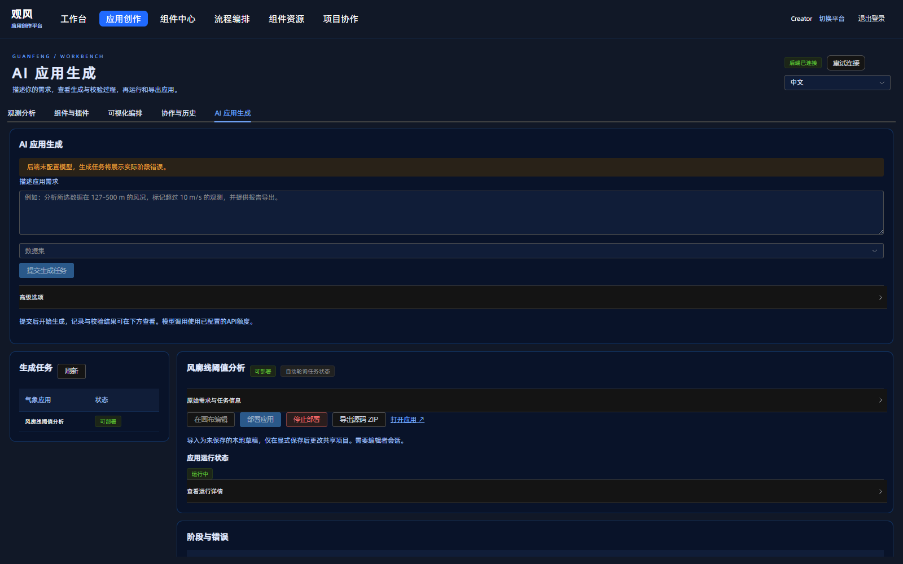
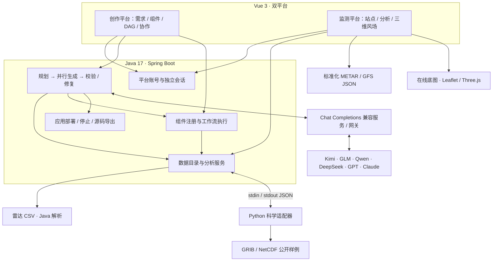

<p align="center"><strong>简体中文</strong> &nbsp;|&nbsp; <a href="README.en.md">English</a></p>

<div align="center">
  
  <h1>观风 · Guanfeng</h1>
  <p><strong>气象应用生成 AI 平台与组件库</strong></p>
  <p>用自然语言描述分析需求，让数据、组件与工作流组成可运行的气象应用。</p>
  <p><a href="#双平台两条业务路径">双平台</a> · <a href="#系统一览">系统一览</a> · <a href="#快速开始windows">快速开始</a> · <a href="#统一模型接入">模型配置</a> · <a href="docs/ARCHITECTURE.md">架构与源码</a></p>
</div>

---

观风把气象分析中反复出现的步骤——读数据、筛选观测、计算统计、识别阈值事件、绘图与导出——组织成可复用组件，再由 AI 编排为应用。你可以从一句“分析指定高度范围内的风速超限事件”开始，选择数据，查看生成与校验过程，最后部署应用或导出源码。

同一套系统还提供面向读图与分析的气象监测平台：从公开站点的原始 METAR 报文，到 GFS 多层风场切片、风羽与粒子，用可追溯的数据理解天气的空间结构。

<div align="center">
  
  <p><sub>三维风场 · 真实系统录屏 · GFS 模式资料快照</sub></p>
</div>

**Java 17 / Spring Boot 承担业务与智能体编排，Vue 3 承担交互与可视化，Python 承担科学文件适配。** 本地服务与科学解码可使用 CPU 运行，无需训练模型或部署本地大模型；AI 生成调用你配置的外部模型 API。浏览器中的三维视图使用 WebGL。

## 双平台，两条业务路径

| | 应用创作平台 | 气象监测平台 |
| :--- | :--- | :--- |
| 入口 | `/login-cloud` → `/cloud` | `/login-network` → `/operations` |
| 从哪里开始 | 选择数据集，描述气象应用需求 | 搜索站点，查看公开观测快照 |
| 如何深入 | AI 应用生成、组件中心、可视化编排、项目协作 | 观测分析、三维站点态势、三维风场、专题工具 |
| 得到什么 | 经校验的应用、运行入口、源码 ZIP、工作流与分析导出 | 站点详情、原始报文、分析图表、模式格点取值与数据导出 |

**创作路径**：选数据 → 写需求 → 模型规划与源码生成 → 校验、构建与修复 → 部署、打开应用 → 导出源码或停止应用。

**监测路径**：选站点 → 切换气温／风速 → 查看时间与原始报文 → 进入观测分析 → 在三维态势和 GFS 风场中探索空间分布。

两个平台分别维护登录会话。项目协作另有编辑者／只读成员和邀请规则，进入创作平台后仍需按项目权限操作。

## 系统一览

以下图片来自仓库现有的实际系统截图；其中任务、修订号和统计卡片是截图时的运行状态，**新安装不携带已生成任务**。

<table>
  <tr>
    <td width="50%"><strong>应用创作工作台</strong><br />数据、生成任务与应用入口集中呈现。<br /></td>
    <td width="50%"><strong>气象监测总览</strong><br />站点列表联动地图，展示公开观测快照。<br /></td>
  </tr>
  <tr>
    <td><strong>可视化工作流</strong><br />连接读取、质控、统计、事件、图表与导出节点。<br /></td>
    <td><strong>三维站点态势</strong><br />在卫星底图中查看站点观测与空间位置。<br /></td>
  </tr>
</table>

**真实 GFS 三维风场**：四个气压层、三个时次，支持风速切片、风羽、流动粒子、点击格点取值与 u/v 数据导出。



<details>
<summary><strong>展开查看：应用生成与部署界面</strong></summary>



截图展示此前生成任务的部署状态；顶部同时提示当前后端未配置模型。部署已有源码与重新调用模型生成是两项独立操作，截图不代表新安装已配置 API 或包含此任务。

</details>

## 核心实现

| 能力 | 实现方式 |
| :--- | :--- |
| 从需求生成应用 | Java 加载生成 Skill 与数据／组件上下文，先规划工作流，再并行生成 Vue 页面和 API 模块，组装 `App.vue`、`api.js` 与 `workflow.json`。 |
| 校验与反馈修复 | 受限源码检查、实际 Vite 构建、DAG 校验、真实数据分析、工作流执行及浏览器检查共同决定任务能否进入 `ready`；失败后最多执行两轮模型修复。 |
| 应用生命周期 | 仅允许部署已通过校验的任务，提供运行入口、停止与源码导出；任务阶段、模型调用元数据和校验结果记录在本地产物中。 |
| 可复用分析组件 | Java 执行数据读取、质量控制、统计、阈值事件、图表与导出；组件按 ID、版本和输入输出契约解析，画布组织 DAG。 |
| 科学文件解码 | Java 通过 stdin/stdout JSON 调用 Python 适配器；cfgrib／ecCodes 读取 GRIB，xarray／netCDF4 处理 NetCDF，前端消费标准化结果。 |
| 项目协作 | 保存项目修订，提供邀请、编辑者／只读角色、版本差异与回滚；项目权限与平台登录分别处理。 |
| 地图与风场 | Leaflet 二维地图、Three.js 三维图层；支持道路／卫星／地形等底图、公开站点快照和 GFS 风场展示。具体底图随视图而异。 |

这是一套有明确数据契约和生成范围的应用生成系统。它生成使用既有本地数据接口的小型 Vue 气象分析应用；任意代码执行、任意科学文件解析和任意业务系统生成均超出当前范围。

## 统一模型接入

**Kimi · GLM · Qwen · DeepSeek · GPT · Claude**

通过统一模型接入层配置端点、模型名与凭据，复用观风的规划、生成、校验和运行流程。选择模型时使用服务商提供的 **Chat Completions 兼容接口或兼容网关**；采用其他原生协议的接口需要适配。

### 1. 准备凭据文件

默认位置为仓库根目录下的 `config/model-api.key`。自行创建，使用 UTF-8 保存**单行、无引号的 API token**，不要提交到 Git。也可以把文件放在仓库外，通过 `GUANFENG_KEY_FILE` 指定其绝对路径。

当前客户端接受 16–512 字符、由字母、数字、下划线和连字符组成的 token；其他凭据格式需要适配客户端。

### 2. 在启动服务的 PowerShell 窗口配置

```powershell
# 使用仓库内文件；也可替换为仓库外凭据文件的绝对路径
$env:GUANFENG_KEY_FILE = Join-Path (Get-Location) 'config\model-api.key'

# 以下为代码默认值；使用其他服务时填写其实际端点与模型 ID
$env:GUANFENG_MODEL_ENDPOINT = 'https://api.deepseek.com/chat/completions'
$env:GUANFENG_MODEL = 'deepseek-flash'

.\scripts\start.ps1
```

| 配置项 | 说明 |
| :--- | :--- |
| `GUANFENG_KEY_FILE` | 凭据文件路径；`start.ps1 -KeyFile` 显式参数优先，未指定时使用本仓库的 `config/model-api.key`。 |
| `GUANFENG_MODEL_ENDPOINT` | **完整的 `/chat/completions` URL**，例如路径含 `/v1/chat/completions` 的兼容端点；客户端不会自动拼接路径。远程地址要求 HTTPS，本机回环地址允许 HTTP。 |
| `GUANFENG_MODEL` | 服务提供方实际支持的模型 ID，支持 `provider/model` 形式；默认 `deepseek-flash` 是代码配置值，可用性与权限以所用服务为准。 |
| `GUANFENG_MODEL_RESPONSE_FORMAT` | 默认请求 JSON object；兼容服务不支持此字段时设为 `false`。返回内容仍须符合生成源码 JSON 契约。 |

项目不自动加载 `.env`。切换配置后，先停止服务，再从已设置环境变量的窗口启动。没有 key 时可以浏览数据、分析与编排；新建 AI 生成任务需要有效的模型配置及服务额度。

统一接入基于上述协议与输出契约，不代表对每个厂商、全部模型版本的逐一实测认证。详细约束见 [模型 API 配置](docs/MODEL_API.md)，实际请求代码见 [DeepSeekClient.java](backend/src/main/java/com/leice/radar/demo/generation/DeepSeekClient.java)。

## 系统架构



METAR 与 GFS 的标准化 JSON 由准备脚本产生，监测视图直接加载，不经过在线模型调用。[架构说明](docs/ARCHITECTURE.md)进一步给出调用路径、源码入口、生成门禁与数据边界。

## 快速开始（Windows）

### 安装运行环境

先安装以下工具，并在**新开的 PowerShell** 中确认可以调用：

| 工具 | 版本与用途 |
| :--- | :--- |
| JDK | **17**，编译与运行 Java 后端；`JAVA_HOME` 指向 JDK 根目录。 |
| Maven | **3.9.x**，`bin` 加入 `PATH`，构建 Java 组件和后端。 |
| Node.js | **20+**，同时提供 `node` 与 `npm`，安装和构建前端及生成应用。 |
| Python | **3.11+**，提供 `python`，安装科学解码与浏览器检查依赖。 |

```powershell
git clone https://github.com/cuitao223/guanfeng.git
cd guanfeng

java -version
mvn -version
node --version
npm --version
python --version
```

脚本支持从 `JAVA_HOME` 或 `PATH` 查找 JDK 17，从 `PATH` 查找 Maven、Node.js 和 Python。仓库不附带 JDK 或 Maven，也不需要 `.tools`；如果系统装有多个 Java 版本，请用 `JAVA_HOME` 明确指定 JDK 17。

### 安装、启动、停止

在仓库根目录执行。若当前 PowerShell 策略阻止脚本，可使用下面仅作用于该次进程的调用方式：

```powershell
# 首次安装：创建 Python 虚拟环境、安装依赖、准备浏览器并构建项目
powershell -NoProfile -ExecutionPolicy Bypass -File .\scripts\setup.ps1

# 启动：同一窗口中的模型环境变量会传给服务
powershell -NoProfile -ExecutionPolicy Bypass -File .\scripts\start.ps1

# 使用完毕后停止
powershell -NoProfile -ExecutionPolicy Bypass -File .\scripts\stop.ps1
```

也可使用根目录的 `安装依赖.cmd`、`启动.cmd` 和 `停止.cmd`。首次安装需要联网访问依赖仓库，并安装 Playwright Chromium；在线底图与模型 API 也需要网络。科学样例可从本地读取。

| 服务 | 默认地址 |
| :--- | :--- |
| 前端统一入口 | `http://127.0.0.1:5274/` |
| Spring Boot 后端 | `http://127.0.0.1:18180/` |
| 经前端代理的业务健康检查 | `http://127.0.0.1:5274/api/wb/health` |

端口以 `scripts/start.ps1` 为准；直接运行 Vite 或 Spring Boot 的源码默认端口可能不同。需要重建时使用 `start.ps1 -Build`，更换端口可传 `-FrontendPort` 和 `-BackendPort`。停止脚本按本项目记录的进程归属停止服务。

### 登录与首次体验

| 平台 | 初始本地账号 | 初始本地密码 |
| :--- | :--- | :--- |
| 应用创作平台 | `creator` | `Guanfeng2026!` |
| 气象监测平台 | `observer` | `Guanfeng2026!` |

账号由后端首次启动初始化，已有账户文件不会被覆盖；后端重启后需重新登录。账号与模型 API key 相互独立。可从 [PortalAuthService.java](backend/src/main/java/com/leice/radar/demo/auth/PortalAuthService.java) 核对初始化逻辑。

第一次体验建议先打开监测总览，再在观测分析中选择数据、执行分析。进入创作平台后，可先浏览组件与工作流；配置好模型，再提交自己的生成需求。新安装的生成记录从空状态开始。

## 数据来源与真实边界

| 数据 | 仓库来源与范围 | 使用边界 |
| :--- | :--- | :--- |
| 雷达 CSV | `data/radar/` 中的 DBS 风廓线与 PPI 扫描样例，由 Java 雷达组件解析。 | 本地历史文件；PPI 是径向风，不直接等同完整水平风矢量；没有真实站址的样例不任意定位到城市。 |
| ERA5 | ECMWF/cfgrib 分发的 2017 年 GRIB1 再分析样例，适配器固定选择首时次、成员 0、850 hPa，可读 `t`／`z`。 | 保留源单位；气压层再分析不等同地面实测，未与雷达作同步或融合。 |
| GOES-16 | NOAA/NESDIS ABI C13 的 2024-01-01 历史 NetCDF 样例，按 `DQF == 0` 过滤，抽点返回网格。 | C13 是红外亮温，单位 K，不是近地空气温度；抽点不等同重网格或插值。 |
| METAR | NOAA Aviation Weather Center 的 39 个公开站点快照，北京时间 **2026-11-12 00:00–00:30**。 | 非实时，不是项目自有在线雷达；保留站号、原始报文、时间与坐标。 |
| GFS | NOAA/NCEP GFS 0.25°；起报 **2026-11-11 12:00 UTC**，f000／f003／f006，925／850／700／500 hPa，112°–120°E、28°–36°N。 | 模式分析／预报快照，不是雷达实测；图层以每层平均位势高度铺平展示，粒子动画速度不代表物理传播时间。 |

数据类型与口径见 [数据来源](docs/DATA_SOURCES.md)，第三方资源与许可范围见 [第三方说明](THIRD_PARTY_NOTICES.md)。公开数据的下载来源、时间、散列与使用条件见 [数据来源说明](data/public/SOURCES.md)、[ERA5／GOES 清单](data/public/manifest.json)、[METAR 清单](data/public/map-observations/manifest.json)及 [GFS 清单](data/public/gfs-wind/manifest.json)。雷达样例的读取与统计以文件实际内容为准，不将它们描述为实时设备接入。

当前科学适配器针对清单中的已校验样例及固定变量／切片工作，未实现任意 GRIB／NetCDF 文件上传或跨资料融合。缺测不会补造为有效值，统计保留有效值计数与数据来源。用户设置的阈值是分析条件，不代表行业安全标准。

平台已实现本机账号验证、独立会话与页面访问控制；旧业务接口与生成应用接口仍有兼容路径，**尚未实现全部 API 的统一授权及按账号隔离数据**。源码限制与生成门禁也不等同于操作系统级隔离沙箱。

## 仓库导航

```text
guanfeng/
├─ frontend/             Vue 3 双平台、工作台、地图与风场
├─ backend/              Java 17 / Spring Boot 业务与生成编排
├─ adapters/             Python 科学数据适配器
├─ generation-template/  应用构建、源码检查、运行与浏览器门禁
├─ .harness/             开发规则、生成 Skill、组件与模板
├─ data/                 雷达样例、公开科学数据与来源清单
├─ config/               模型配置说明；密钥自行创建
├─ scripts/              Windows 安装、启动、停止与检查
├─ tests/                数据、Java 集成及浏览器检查
└─ docs/                 使用说明、架构与实际系统截图
```

源码仓库不附带 `.tools`、`node_modules`、`dist`、`target`、`runtime`、API key 或预生成任务，也不依赖比赛报告或演示文稿启动。依赖、构建结果及运行数据在本机安装和使用时产生。

| 深入了解 | 文档 |
| :--- | :--- |
| 架构、生成链路与源码入口 | [架构说明](docs/ARCHITECTURE.md) |
| 模型端点、凭据及协议约束 | [模型 API 配置](docs/MODEL_API.md) |
| 双平台操作与会话 | [双平台使用指南](docs/PORTAL_GUIDE.md) |
| GRIB／NetCDF 解码契约 | [科学数据适配器](adapters/README.md) |
| GFS 风场实现与科学边界 | [真实三维风场](docs/REAL_WIND_SCENE.md) |
| 组件与资源入口 | [入口与工具说明](docs/RESTORED_ENTRIES.md) |
| 数据来源与口径 | [数据来源](docs/DATA_SOURCES.md) |
| 第三方资源与许可范围 | [第三方说明](THIRD_PARTY_NOTICES.md) |
