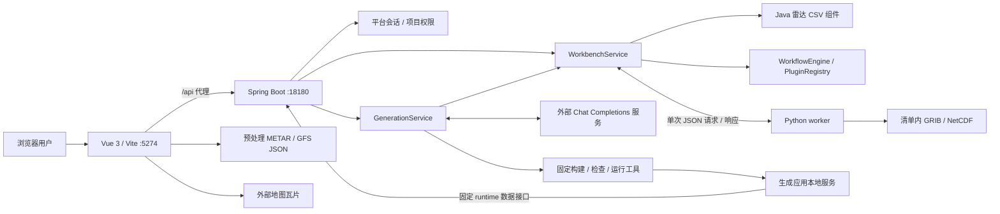
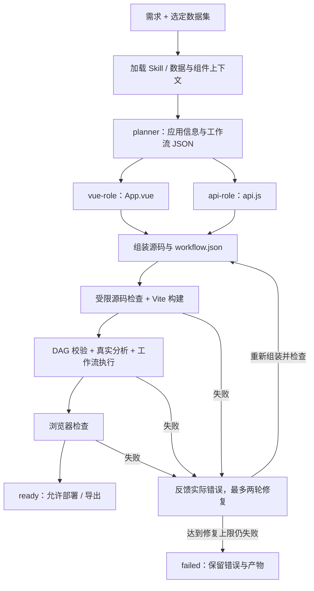

# 观风架构与实现

[返回项目首页](../README.md)

观风由双平台前端、Java 业务与生成服务、Python 科学适配器、组件描述及应用运行模板组成。业务与智能体编排在 Java 中完成；Python 负责已有科学资料的解码与标准化。模型通过外部 API 调用，本机无需训练模型。

## 1. 运行边界

| 层 | 职责 | 主要源码 |
| :--- | :--- | :--- |
| Vue 3 前端 | 双平台入口、登录、应用生成、分析画布、项目协作、二维地图与三维展示 | [`frontend/src/views/`](../frontend/src/views/)、[`frontend/src/components/`](../frontend/src/components/) |
| Spring Boot | HTTP 接口、平台身份、数据目录、分析、组件执行、生成任务与应用管理 | [`backend/src/main/java/com/leice/radar/demo/`](../backend/src/main/java/com/leice/radar/demo/) |
| 生成运行模板 | 受限源码检查、Vite 构建、浏览器检查、生成应用的本地运行服务 | [`generation-template/`](../generation-template/) |
| Python 子进程 | 解析清单内的 GRIB／NetCDF，输出标准化数据与来源信息 | [`adapters/worker.py`](../adapters/worker.py) |
| 数据准备 | 下载、校验并标准化公开资料；准备 GFS 风场 JSON | [`adapters/fetch_public_data.py`](../adapters/fetch_public_data.py)、[`scripts/prepare_gfs_wind.py`](../scripts/prepare_gfs_wind.py) |
| 组件与规则 | 组件版本、参数、输入输出契约、受限扩展表达式及生成 Skill | [`PluginRegistry`](../backend/src/main/java/com/leice/radar/demo/workbench/PluginRegistry.java)、[生成 Skill](../.harness/backend/skills/guanfeng-generate/SKILL.md) |

默认 Windows 启动入口为 `scripts/start.ps1`：前端绑定 `127.0.0.1:5274`，后端绑定 `127.0.0.1:18180`。脚本生成本机 Vite 代理配置，并检查前端、后端及经前端代理的业务健康接口；它启动的是 Vite 服务，不是面向公网的生产部署。

站点与 GFS 视图直接加载前端标准化 JSON；它们不需要模型生成，也不由 Python 在每次地图交互时重新解码。外部模型 API 与地图瓦片需要网络，本地数据分析使用已经保存的样例。

## 2. 双平台与身份

业务入口 `/` 分流到应用创作平台和气象监测平台：

- 创作：`/login-cloud` → `/cloud`，进入应用生成、组件、编排和协作。
- 监测：`/login-network` → `/operations`，进入站点、观测分析、三维站点态势与 `/operations/wind` 风场。

[`PortalAuthService`](../backend/src/main/java/com/leice/radar/demo/auth/PortalAuthService.java) 首次启动时创建 `runtime/auth/accounts.json`，种子账号为 `creator`、`observer`，初始密码均为 `Guanfeng2026!`。密码使用带盐 PBKDF2 派生值存储，已有账号文件不会被覆盖。两个平台使用独立的 HttpOnly 会话 Cookie，会话存于后端内存，有效期 8 小时；后端重启后需重新登录。

平台身份控制与项目协作权限分别实现。[`ProjectStore`](../backend/src/main/java/com/leice/radar/demo/workbench/ProjectStore.java) 维护项目会话、邀请、编辑者／只读成员、修订记录、差异和回滚。登录创作平台不自动授予项目编辑权限。

当前的本机身份和页面控制尚未覆盖所有历史业务 API、Harness 接口及生成应用接口，也没有实现按平台账号隔离全部数据；此架构不构成完整的生产多租户授权体系。

## 3. 应用生成：需求如何变成源码

主要入口为 [`GenerationController`](../backend/src/main/java/com/leice/radar/demo/generation/GenerationController.java) 与 [`GenerationService`](../backend/src/main/java/com/leice/radar/demo/generation/GenerationService.java)。

1. **读取上下文**：`generate()` 加载 `.harness/backend/skills/guanfeng-generate/SKILL.md`，记录路径、加载时间与 SHA-256，同时读取真实数据元信息及组件 ID、版本、参数等。
2. **规划**：`planner` 返回标题、描述和工作流，不把自由文本直接当作执行指令。
3. **并行生成**：`vue-role` 与 `api-role` 分别返回约定 JSON 中的 Vue 源码和 API 源码。角色是同一 Java 服务组织的模型请求，不是额外的 Python 智能体服务。
4. **组装与留存**：`assemble()` 写入任务目录，复制固定构建、源码检查与运行工具，保留各轮源码快照。
5. **实际校验**：`validate()` 运行构建和源码限制，校验 DAG，执行真实数据分析与工作流，再运行浏览器检查；分析结果需存在有效观测值。
6. **修复与状态**：失败反馈包含实际校验错误，最多两轮修复，每轮重新检查；全部通过才标记 `ready`，失败保留阶段记录，不转成可部署任务。

源码检查与调用限制见 [`validate-source.cjs`](../generation-template/validate-source.cjs)、[`build.cjs`](../generation-template/build.cjs) 和 [`browser-check.cjs`](../generation-template/browser-check.cjs)。这些检查限定生成应用的模块、调用方式与数据接口，不等同于操作系统级隔离沙箱，也不证明任意需求都能生成成功。

## 4. 统一模型接入

[`DeepSeekClient`](../backend/src/main/java/com/leice/radar/demo/generation/DeepSeekClient.java) 是当前兼容客户端的类名，运行端点由配置决定。Kimi、GLM、Qwen、DeepSeek、GPT、Claude 等模型可经 Chat Completions 兼容端点或网关接入同一生成流程；其他原生协议需要适配。

请求使用 Bearer 凭据、system／user 消息、非流式 JSON POST，从 `choices[0].message.content` 读取结果。默认请求 JSON object 响应格式，可以通过 `GUANFENG_MODEL_RESPONSE_FORMAT=false` 关闭该字段，但返回内容仍需满足各生成角色的 JSON 契约。

| 配置 | 代码行为 |
| :--- | :--- |
| `GUANFENG_KEY_FILE` | 请求时读取文件中的 token；正常启动脚本默认指定本仓库 `config/model-api.key`，也可传 `-KeyFile` 或外部文件路径。 |
| `GUANFENG_MODEL_ENDPOINT` | 完整 URL，路径必须以 `/chat/completions` 结尾；远程 HTTPS，本机回环允许 HTTP；不接受 URL 用户信息、查询参数或片段，不自动跟随重定向。 |
| `GUANFENG_MODEL` | 默认 `deepseek-flash`，支持兼容服务的实际模型 ID；生成请求也可指定模型覆盖。 |

当前 token 校验接受 16–512 字符的 `[A-Za-z0-9_-]`。连接超时为 15 秒，请求超时为 150 秒；空内容、达到 token 上限导致的截断及不合约定的结果会失败。上述是代码限制，不是性能或成功率承诺。

实际支持范围由协议兼容性、凭据格式、模型输出和后续检查共同决定，不能由厂商名称推断所有版本均已实测。详细配置见 [README](../README.md#统一模型接入) 与 [模型 API 配置](MODEL_API.md)。

## 5. 数据分析与工作流

[`WorkbenchService`](../backend/src/main/java/com/leice/radar/demo/workbench/WorkbenchService.java) 提供 `datasets()`、`dataset()`、`analyze()`、`validateWorkflow()` 和 `runWorkflow()` 等入口。雷达 CSV 由 Java 组件解析，科学资料通过 `adapter()` 调用 Python。

[`WorkflowEngine`](../backend/src/main/java/com/leice/radar/demo/workbench/WorkflowEngine.java) 在运行前解析组件版本与参数，检查节点、边、端口类型和有向无环结构。当前输入约束是读取节点无输入、每个非读取节点恰有一个上游；它不是支持任意多输入融合的通用 DAG 引擎。

典型链路为 `reader → quality → statistics → events`，并分支到 `chart`、`export`。执行按拓扑顺序传递结果，节点前后校验输入输出，记录节点状态与导出产物。DBS 的高度、时间、方向有效性和阈值处理依据实际数据；PPI 与网格按各自的数据含义分析。

[`PluginRegistry`](../backend/src/main/java/com/leice/radar/demo/workbench/PluginRegistry.java) 按组件 ID 和版本解析描述，检查启用状态、参数及输入输出；内置组件以 Java 分支执行，扩展表达式使用受限求值器，不能理解为任意插件代码执行。

[`WorkflowRunService`](../backend/src/main/java/com/leice/radar/demo/workbench/WorkflowRunService.java) 提供异步提交与状态查询，并与同步执行入口共存。协作保存与工作流执行分别维护状态，避免把未保存画布变化自动写为共享项目修订。

## 6. Python 科学适配

`WorkbenchService.adapter()` 启动 `adapters/worker.py`，通过 stdin 发送一个 JSON 请求，通过 stdout 接收一个 JSON 响应。Python 不读取模型 key，也不承担规划、会话或业务 HTTP 服务。

- 请求按数据 ID 访问清单内已验证的文件，不接收任意文件路径。
- GRIB 使用 cfgrib／ecCodes，NetCDF 使用 xarray／netCDF4，保留原始单位、坐标、时间及来源。
- 二维数据为 `values[yIndex][xIndex]`；缺测与质量掩码参与统计，有效 0 保留，全缺测统计返回 null。
- GOES C13 按 `DQF == 0` 选择好像元，并明确抽点范围；统计针对返回网格。
- ERA5 当前固定首时次、成员 0、850 hPa，可选变量 `t`／`z`，不是任意维度浏览器。

文件完整性、响应结构与支持范围见 [适配器说明](../adapters/README.md)、[`read-response.schema.json`](../adapters/read-response.schema.json) 和 [数据来源说明](../data/public/SOURCES.md)。

## 7. 地图、站点与三维风场

| 视图 | 数据路径 | 展示边界 |
| :--- | :--- | :--- |
| 二维站点与三维站点态势 | [`metar-observations.json`](../frontend/src/data/metar-observations.json)、[`WeatherObservations/`](../frontend/src/components/WeatherObservations/) | 39 个 METAR 站点历史快照；可查看时间和报文，不表示在线自有雷达。 |
| GFS 三维风场 | [`gfs-wind.json`](../frontend/src/data/gfs-wind.json)、[`prepare_gfs_wind.py`](../scripts/prepare_gfs_wind.py) | 真实模式 u/v/HGT，四层三时次；分析／预报快照，不是雷达实测。 |
| 二维底图 | [`RealMap/`](../frontend/src/components/RealMap/)、[`basemaps.js`](../frontend/src/utils/maps/basemaps.js) | 在线瓦片含来源署名、加载与重试，实际可用性依赖网络及提供方。 |

原始坐标保留 WGS84，高德显示进行 GCJ-02 转换。雷达样例没有真实站址时不任意叠加到城市。GFS 气压面以各层平均位势高度铺平，区域投影与垂直放大用于展示，动画步长不表示真实传播时间。详见 [真实三维风场](REAL_WIND_SCENE.md)。

公开历史资料来自不同时间、区域与观测／模式系统，没有实现与雷达的同步、重网格或资料融合；不能从并列展示推断精度提高或预报能力。

## 8. 应用生命周期与本地状态

`GenerationService.deploy()` 仅接受 `ready` 任务，使用固定 Node 运行工具启动本地应用；停止与查询依据实际进程状态。后端重启时，旧运行记录不会直接视作健康部署。生成应用通过固定的 `/runtime/...` 数据操作复用后端分析能力。

| 本机产生的路径 | 内容 |
| :--- | :--- |
| `.venv/`、`frontend/node_modules/` | 本机 Python／Node 依赖。 |
| `backend/target/`、`frontend/dist/` 等构建目录 | Java 与前端构建结果。 |
| `runtime/generation/` | 生成任务、源码快照、调用元数据、校验与应用运行产物。 |
| `runtime/auth/accounts.json` | 首次启动初始化的本机账号存储。 |
| `scripts/.state/` | 启停脚本的进程归属记录与本次运行信息。 |

源码发布不附带上述依赖、构建与运行状态，也不附带 `.tools` 或模型凭据。真实系统截图中的任务与计数仅说明截图时的状态，不代表新安装预置成果。组件注册器在运行时创建或读取可选的 `plugins/` 目录，内置组件在 Java 中定义，不要求源码发布预置该目录。

Windows 安装需要用户准备 JDK 17、Maven 3.9、Node.js 20+、Python 3.11+。`common.ps1` 支持 `JAVA_HOME`／`PATH`：JDK 可由 `JAVA_HOME` 指定或从 `PATH` 发现，Maven 从 `PATH` 查找；已有本项目 `.tools` 时可选用，但公开安装不需要该目录。具体安装与端口配置见 [快速开始](../README.md#快速开始windows)。

资料口径见 [数据来源](DATA_SOURCES.md)，资源来源与许可范围见 [第三方说明](../THIRD_PARTY_NOTICES.md)。
